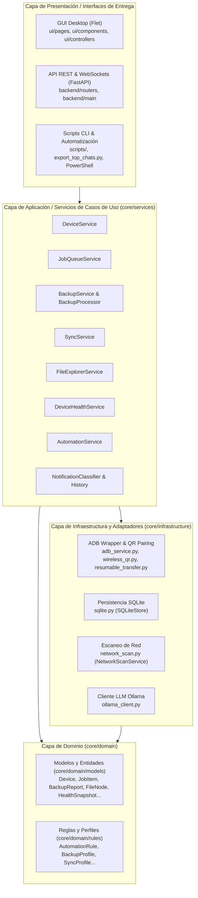

# Arquitectura por Capas de Android Tools

Este documento define la estructura en capas (Layered Architecture / Clean Architecture) del sistema **Android Tools**, explicando las responsabilidades de cada nivel, el flujo de dependencias y la separación de preocupaciones.

---

## 1. Visión General de las Capas

El proyecto está organizado en **capas concéntricas**, donde las dependencias fluyen estrictamente desde las capas externas hacia las capas internas (Regla de Dependencia). Las capas de presentación y entrega jamás deben contener reglas de negocio ni lógica de infraestructura.

---

## 2. Detalle de Cada Capa

### Capa 1: Dominio (`core/domain`)
Es el corazón de la aplicación. No depende de ninguna capa externa ni de frameworks de UI o API. Contiene las definiciones esenciales del negocio y las entidades tipadas.

* **`core/domain/models/`**:
  * [`adb.py`](file:///c:/Users/Desarrollo/Documents/Android/core/domain/models/adb.py): Entidades `Device`, `DeviceState`, `ConnectionMode`, `ConnectionAttempt`, `OperationResult`, `AdbError`, `TransferJob`, `BackupManifest`.
  * [`jobs.py`](file:///c:/Users/Desarrollo/Documents/Android/core/domain/models/jobs.py): Entidades `JobItem`, `JobStatus`, `JobType`, evaluación de errores transitorios `is_error_transient`.
  * [`backup.py`](file:///c:/Users/Desarrollo/Documents/Android/core/domain/models/backup.py): `BackupFile`, `BackupReport`, `BackupDiff`.
  * [`device_health.py`](file:///c:/Users/Desarrollo/Documents/Android/core/domain/models/device_health.py): `DeviceHealthSnapshot`, `HealthStatus`, `HealthTrend`, `DeviceHealthTrends`.
  * [`explorer.py`](file:///c:/Users/Desarrollo/Documents/Android/core/domain/models/explorer.py): `FileNode`, `ExplorerFilter`, `SearchResult`, `BulkOperationResult`.
  * [`ai.py`](file:///c:/Users/Desarrollo/Documents/Android/core/domain/models/ai.py): Clasificaciones de notificaciones (`NotificationClassification`), reportes diagnósticos (`BackupAnalysisReport`, `DaySummary`, `AutomationSuggestion`).
  * [`sync.py`](file:///c:/Users/Desarrollo/Documents/Android/core/domain/models/sync.py): `SyncProfile`, `SyncRule`, `SyncDirection`, `ConflictResolution`.

* **`core/domain/rules/`**:
  * [`automation_rules.py`](file:///c:/Users/Desarrollo/Documents/Android/core/domain/rules/automation_rules.py): Triggers, condiciones y acciones de reglas automáticas.
  * [`backup_profiles.py`](file:///c:/Users/Desarrollo/Documents/Android/core/domain/rules/backup_profiles.py): Perfiles declarativos de respaldo (`full`, `multimedia`, `apps`, etc.).
  * [`sync_profiles.py`](file:///c:/Users/Desarrollo/Documents/Android/core/domain/rules/sync_profiles.py): Reglas y configuraciones de sincronización de carpetas.
  * [`notification_rules_fallback.py`](file:///c:/Users/Desarrollo/Documents/Android/core/domain/rules/notification_rules_fallback.py): Reglas regex deterministas para clasificación de notificaciones sin depender de IA.

---

### Capa 2: Infraestructura (`core/infrastructure`)
Encapsula la comunicación con el hardware, sistema operativo, procesos externos, base de datos y servicios de red.

* **`core/infrastructure/adb/`**:
  * [`adb_service.py`](file:///c:/Users/Desarrollo/Documents/Android/core/infrastructure/adb/adb_service.py): Adaptador de comandos `adb.exe`, timeouts, sanitización y pooling.
  * [`resumable_transfer.py`](file:///c:/Users/Desarrollo/Documents/Android/core/infrastructure/adb/resumable_transfer.py): Motor de hashing SHA-256 e integridad de transferencias.
  * [`wireless_qr.py`](file:///c:/Users/Desarrollo/Documents/Android/core/infrastructure/adb/wireless_qr.py): Emparejamiento por código QR y descubrimiento mDNS.
* **`core/infrastructure/database/`**:
  * [`sqlite.py`](file:///c:/Users/Desarrollo/Documents/Android/core/infrastructure/database/sqlite.py): Repositorio `SQLiteStore` para auditoría, persistencia de automatizaciones y estadísticas.
* **`core/infrastructure/network/`**:
  * [`network_scan.py`](file:///c:/Users/Desarrollo/Documents/Android/core/infrastructure/network/network_scan.py): Escaneo de puertos TCP y subredes locales con `nmap` o sockets.
* **`core/infrastructure/ai/`**:
  * [`ollama_client.py`](file:///c:/Users/Desarrollo/Documents/Android/core/infrastructure/ai/ollama_client.py): Cliente HTTP para modelos LLM locales en Ollama.
* **`core/infrastructure/system/`**:
  * [`monitor_service.py`](file:///c:/Users/Desarrollo/Documents/Android/core/infrastructure/system/monitor_service.py): Monitoreo de procesos y captura de notificaciones.

---

### Capa 3: Servicios de Aplicación (`core/services`)
Orquesta los casos de uso del sistema. Conecta el dominio con la infraestructura y mantiene la lógica de coordinación.

* [`device_service.py`](file:///c:/Users/Desarrollo/Documents/Android/core/services/device_service.py): Administración del inventario de dispositivos, reconexión inteligente y migración de registro.
* [`job_queue_service.py`](file:///c:/Users/Desarrollo/Documents/Android/core/services/job_queue_service.py): Cola multihilo de trabajos concurrentes con workers secuenciales por teléfono.
* [`backup_service.py`](file:///c:/Users/Desarrollo/Documents/Android/core/services/backup_service.py) y [`backup_processor.py`](file:///c:/Users/Desarrollo/Documents/Android/core/services/backup_processor.py): Orquestación completa de respaldo y normalización a JSON/Excel.
* [`backup_analyzer_service.py`](file:///c:/Users/Desarrollo/Documents/Android/core/services/backup_analyzer_service.py): Análisis diagnóstico inteligente de fallos y recomendaciones.
* [`sync_service.py`](file:///c:/Users/Desarrollo/Documents/Android/core/services/sync_service.py): Motor de sincronización bidireccional y resolución de conflictos.
* [`transfer_service.py`](file:///c:/Users/Desarrollo/Documents/Android/core/services/transfer_service.py): Cola de transferencias de archivos directas.
* [`file_explorer_service.py`](file:///c:/Users/Desarrollo/Documents/Android/core/services/file_explorer_service.py): Navegación y operaciones seguras en el almacenamiento remoto.
* [`device_health_service.py`](file:///c:/Users/Desarrollo/Documents/Android/core/services/device_health_service.py): Telemetría de batería, almacenamiento, temperatura y RAM.
* [`automation_service.py`](file:///c:/Users/Desarrollo/Documents/Android/core/services/automation_service.py) y [`automation_suggestion_service.py`](file:///c:/Users/Desarrollo/Documents/Android/core/services/automation_suggestion_service.py): Motor de automatizaciones reactivas y sugerencias asistidas por IA.
* [`notification_classifier.py`](file:///c:/Users/Desarrollo/Documents/Android/core/services/notification_classifier.py) y [`notification_history.py`](file:///c:/Users/Desarrollo/Documents/Android/core/services/notification_history.py): Clasificación y consulta de historial de alertas.

---

### Capa 4: Automatización UI de Android (`ui_automation/`)
Contiene los módulos específicos de control e interacción directa con apps en el dispositivo físico:
* `ui_automation/whatsapp/`: Extracción automatizada de chats de WhatsApp, parseo y comunicación con el receptor Java APK (`androidtools_receiver`).
* `ui_automation/device.py`, `adb_manager.py`, `watchers.py`: Monitores de interfaz y controladores UIAutomator.

---

### Capa 5: Presentación y Entrega (`ui/`, `backend/`, `scripts/`)
Interfaces de usuario y puntos de entrada públicos:

1. **API Local FastAPI (`backend/`)**:
   * [`backend/main.py`](file:///c:/Users/Desarrollo/Documents/Android/backend/main.py), [`backend/deps.py`](file:///c:/Users/Desarrollo/Documents/Android/backend/deps.py), [`backend/websocket.py`](file:///c:/Users/Desarrollo/Documents/Android/backend/websocket.py).
   * Routers REST: `devices.py`, `backups.py`, `explorer.py`, `jobs.py`, `sync.py`.
   * **Desacoplado**: Importa exclusivamente desde `core.*`. No depende de la GUI.
2. **GUI Desktop Flet (`ui/`)**:
   * [`ui/pages/`](file:///c:/Users/Desarrollo/Documents/Android/ui/pages/): Vistas interactivas (`devices_page`, `backup_page`, `explorer_page`, `whatsapp_page`, etc.).
   * [`ui/components/`](file:///c:/Users/Desarrollo/Documents/Android/ui/components/): Componentes reutilizables (`job_drawer`, `log_view`, `sidebar`, `status_card`).
   * [`ui/controllers/`](file:///c:/Users/Desarrollo/Documents/Android/ui/controllers/): Controladores delgados de integración.
3. **Scripts CLI & Entrypoints**:
   * `export_top_chats.py`, `monitor_notificaciones.py`, scripts PowerShell (`setup.ps1`, `android_reconnect.ps1`).

---

### Capa de Compatibilidad Retroactiva (`ui/services/`)
Para garantizar que ningún script existente, comando o prueba previa se rompa, todos los archivos dentro de `ui/services/*.py` actúan como **fachadas delegadoras** mediante alias de `sys.modules`:
* Si un código importa `from ui.services.device_service import DeviceService`, se redirige automáticamente y sin sobrecoste a `core.services.device_service.DeviceService`.
* Permite migrar código gradualmente manteniendo el 100% de compatibilidad con suites de pruebas existentes.

